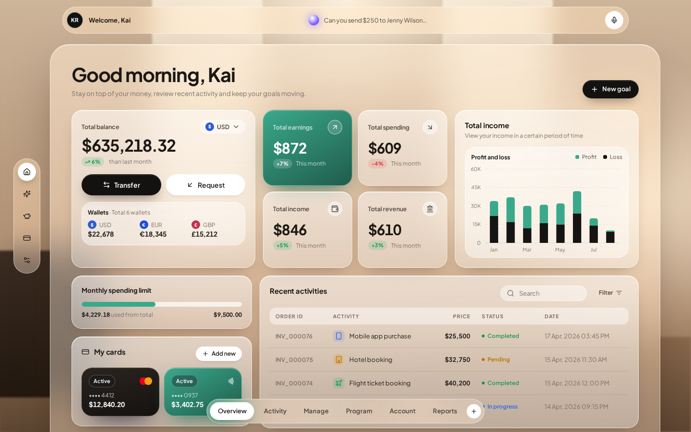
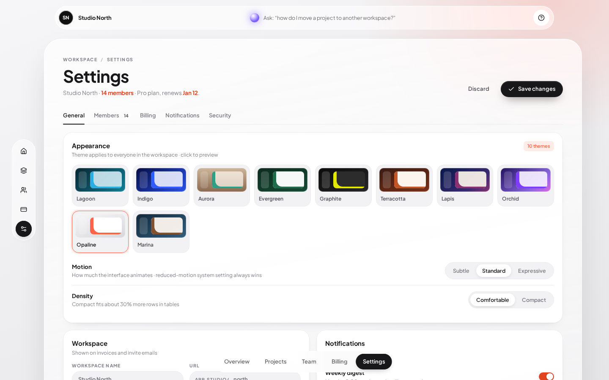
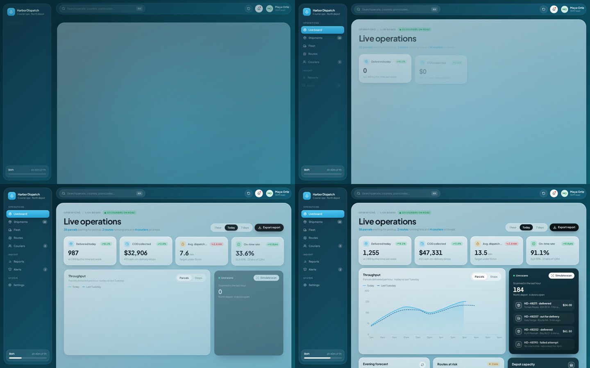
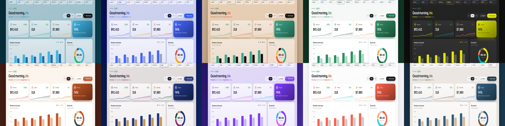

# admin-dashboard-vista

**vista-ui** là một *skill* cho agent LLM (Claude Code, Codex, Cursor, Copilot, Windsurf… hoặc bất kỳ
model nào đọc được markdown) giúp tạo ra giao diện dashboard **glassmorphism** đẹp như các shot trên Dribbble:
panel kính mờ trên nền gradient, sidebar nổi, thẻ KPI số lớn, biểu đồ SVG mượt và các nút dạng viên thuốc (pill) —
kèm **chuyển động chuyên nghiệp**: trang hiện ra theo một trình tự được dàn dựng, biểu đồ tự vẽ, số đếm lên,
viên "active" trượt giữa các lựa chọn, ánh sáng chạy theo con trỏ trên mặt kính, toast/skeleton/undo mượt mà.

| Lagoon | Indigo |
|---|---|
|  |  |
| **Aurora (spatial)** | **Evergreen (notch)** |
|  |  |
| **Graphite (dark) · SaaS analytics** | **Terracotta (notch) · Reservations** |
|  |  |
| **Orchid · Support inbox** | **Opaline (light) · Settings** |
|  |  |
| **Motion · Live operations** | **Entrance filmstrip (120 → 300 → 500 → 800 ms)** |
|  |  |

## Có gì bên trong

```
skills/vista-ui/
├── SKILL.md                 # điểm vào: quy trình 7 bước cho agent
├── assets/
│   ├── vista.css            # design system: token, 10 theme, 3 shell, ~50 component (prefix vx-)
│   ├── vista-charts.js      # biểu đồ SVG không phụ thuộc: bar, line, area, donut, gauge, ring, sparkline (có hiệu ứng vẽ)
│   ├── vista-motion.js      # engine chuyển động: entrance, scroll reveal, count-up, glider, glow/tilt, toast, FLIP
│   ├── vista.js             # icon + toggle cho segmented/chips/tabs/switch, đổi theme trực tiếp
│   └── vendor/lucide.min.js # bộ icon Lucide (ISC) — chạy offline
├── templates/               # khung trang: sidebar.html · notch.html · spatial.html
├── examples/                # 9 trang hoàn chỉnh (8 theme, nhiều kiểu trang) + theme-gallery.html + index.html (gallery)
├── references/              # tài liệu sâu, agent chỉ đọc khi cần
│   ├── design-language.md   # "ADN" thị giác của phong cách, nên/không nên
│   ├── themes.md            # 10 theme, chọn theme theo sản phẩm, generator, theme thương hiệu, dark mode
│   ├── palettes.md / .json  # thư viện 53 bảng màu theo cảm xúc (tối giản, ấm, lạnh, rực rỡ, hiện đại)
│   ├── components.md        # HTML copy‑paste cho mọi component
│   ├── layouts.md           # các shell + công thức trang (overview, analytics, bảng, gallery, inbox…)
│   ├── charts.md            # API biểu đồ
│   ├── motion.md            # ngôn ngữ chuyển động: token, entrance, pattern, công thức, a11y
│   ├── framework-port.md    # dùng trong React/Next, Vue, Svelte, Tailwind, shadcn
│   └── checklist.md         # checklist QA trước khi giao
└── scripts/
    ├── scaffold.py          # tạo trang mới từ template (copy hoặc nhúng asset)
    ├── bundle.py            # gộp CSS/JS vào 1 file HTML duy nhất
    ├── palette_theme.py     # bảng màu / mã hex → theme Vista đầy đủ + báo cáo độ tương phản
    └── screenshot.py        # chụp PNG + báo lỗi console, icon sai tên, chart rỗng, placeholder sót; --frames = filmstrip motion
adapters/system-prompt.md    # prompt rút gọn cho agent không đọc được thư mục skill
install.sh                   # cài skill cho từng loại agent
AGENTS.md                    # chỉ dẫn cho agent làm việc trong chính repo này
```

## 10 theme



| Theme | Cảm giác | Shell | Hợp với |
|---|---|---|---|
| `lagoon` | kính xanh ngọc/cyan, nút CTA đen | sidebar | admin, bất động sản, B2B |
| `indigo` | kính xanh hoàng gia, sidebar navy | sidebar | e‑commerce, analytics, SaaS |
| `aurora` | kính ấm kiểu visionOS trên nền phòng | spatial (top bar + rail + dock) | tài chính cá nhân, consumer |
| `evergreen` | khung xanh rêu, panel trắng, tab "notch" | notch | CRM, sales, productivity |
| `graphite` | dark mode thật: than chì, điểm nhấn vàng chanh | sidebar | dev tools, monitoring, analytics |
| `terracotta` | nâu than hồng, panel kem, cam đất | notch | nhà hàng, khách sạn, nội thất |
| `lapis` | xanh lapis đêm, ánh tím mận, panel ngà | sidebar | tài sản, cao cấp, pháp lý |
| `orchid` | tím rực → hồng, kính oải hương | sidebar | creator, support, AI |
| `opaline` | sáng tối giản, xám ngọc trai, cam san hô | spatial / sidebar | settings, billing, SaaS tối giản |
| `marina` | navy bến cảng, panel cát, điểm nhấn nâu | sidebar | du lịch, hàng hải, logistics |

Đổi theme: `<html data-theme="indigo">`. Xem cả 10 theme: `examples/theme-gallery.html`.

**Thêm màu sắc:** thư viện 53 bảng màu trong `references/palettes.md`, và một lệnh để biến bảng màu
(hoặc mã màu thương hiệu) thành theme hoàn chỉnh:
```bash
python3 skills/vista-ui/scripts/palette_theme.py --list                     # duyệt 53 bảng màu
python3 skills/vista-ui/scripts/palette_theme.py 21 --name fireside --out fireside.css
python3 skills/vista-ui/scripts/palette_theme.py "#0F4C81,#F2E8DC,#E07A5F" --name acme
```

## Chuyển động

Chỉ cần `<script src="vista-motion.js"></script>` trong `<head>` (template đã có sẵn):

| Khoảnh khắc | Chuyển động |
|---|---|
| Mở trang | sidebar trượt vào → panel lắng xuống → tiêu đề → các card nổi lên theo thứ tự đọc (stagger 45ms) |
| Cuộn | card bên dưới nổi lên khi vào khung nhìn |
| Số liệu | KPI đếm từ 0, giữ độ rộng để không xô lệch; cập nhật trực tiếp nháy xanh/đỏ (`countTo`) |
| Biểu đồ | cột mọc lên kiểu lò xo, đường quét trái → phải, donut/gauge/ring quét vòng; đổi kỳ thì vẽ lại |
| Chọn | segmented / tabs / nav / dock: một viên "active" trượt bằng spring |
| Rê chuột | ánh sáng theo con trỏ + viền sáng (`vx-glow`), nghiêng 3D (`vx-tilt`), CTA lóe sáng |
| Thao tác | nhấn co nhẹ; nút loading; toast kính có thanh đếm ngược, dừng khi hover, Undo; dòng mới trượt vào, các dòng khác dạt ra (FLIP) |

Mức độ: `<html data-vx-motion="subtle|standard|expressive|off">`. `prefers-reduced-motion` luôn được tôn trọng.
Chi tiết: `skills/vista-ui/references/motion.md`; xem trực tiếp: `examples/lagoon-live-ops-motion.html`.

## Cài đặt

```bash
./install.sh claude                 # Claude Code, dùng cho mọi project (~/.claude/skills/vista-ui)
./install.sh claude-project ~/app   # Claude Code, chỉ một project
./install.sh codex ~/app            # Codex / agent đọc AGENTS.md
./install.sh cursor ~/app           # Cursor (.cursor/rules/vista-ui.mdc)
./install.sh copilot ~/app          # GitHub Copilot (.github/copilot-instructions.md)
./install.sh windsurf ~/app         # Windsurf (.windsurf/rules)
```
ChatGPT / Gemini / API thuần: dán `adapters/system-prompt.md` vào system prompt, đính kèm `vista.css` và một file ví dụ.

## Dùng thử

Sau khi cài, chỉ cần yêu cầu agent, ví dụ:
> "Tạo dashboard quản lý phòng gym: hội viên, doanh thu tháng, lớp học hôm nay, theme evergreen."

Hoặc tự làm bằng tay:
```bash
python3 skills/vista-ui/scripts/scaffold.py --shell sidebar --theme lagoon --title "Gym — Overview" --out out/gym.html
# sửa các [[placeholder]] …
python3 skills/vista-ui/scripts/screenshot.py out/gym.html --full      # kiểm tra trực quan
python3 skills/vista-ui/scripts/screenshot.py out/gym.html --frames 0,150,300,600   # filmstrip chuyển động
python3 skills/vista-ui/scripts/bundle.py out/gym.html -o out/gym.single.html   # 1 file để chia sẻ
```
Script chụp màn hình cần Playwright: `pip install playwright && python -m playwright install --with-deps chromium`.

Xem nhanh các ví dụ: mở `skills/vista-ui/examples/index.html` trong trình duyệt.

## Ghi chú
- Font Plus Jakarta Sans tải từ Google Fonts (offline sẽ fallback sang Inter/system). Ảnh trong ví dụ lagoon lấy từ Unsplash.
- Icon: Lucide (ISC, xem `assets/vendor/LUCIDE-LICENSE.txt`).
