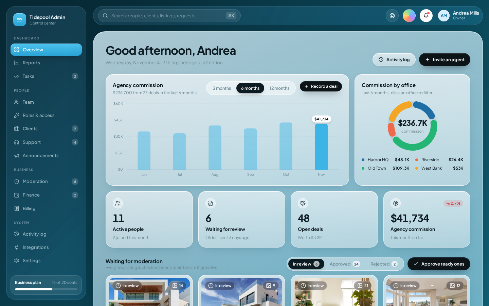
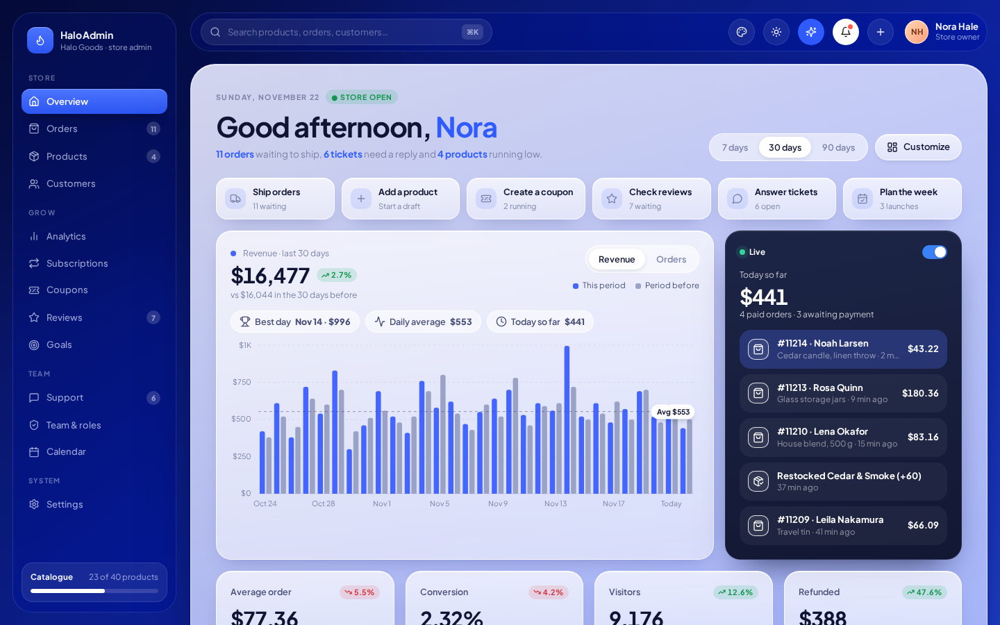
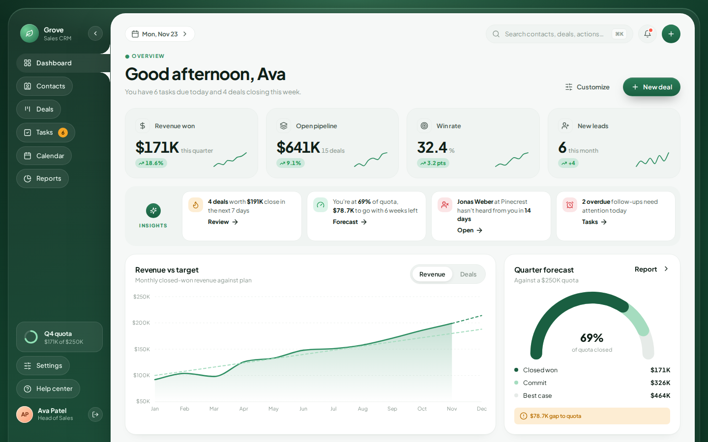
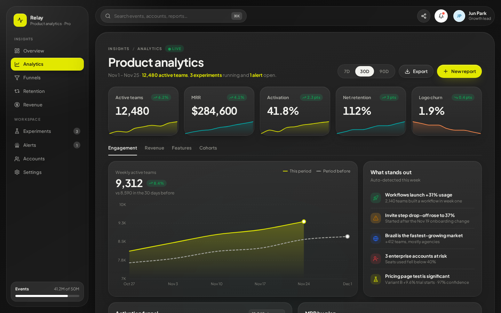
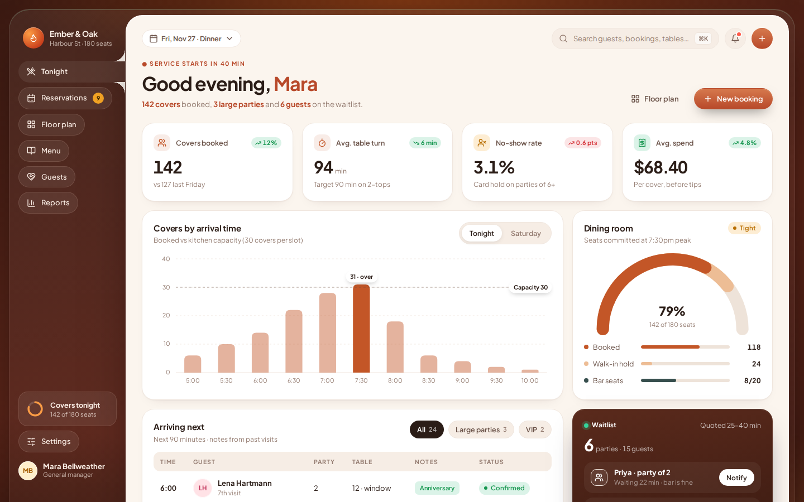
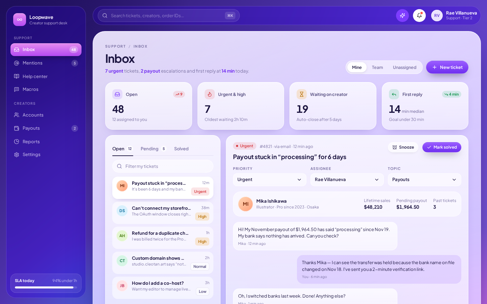
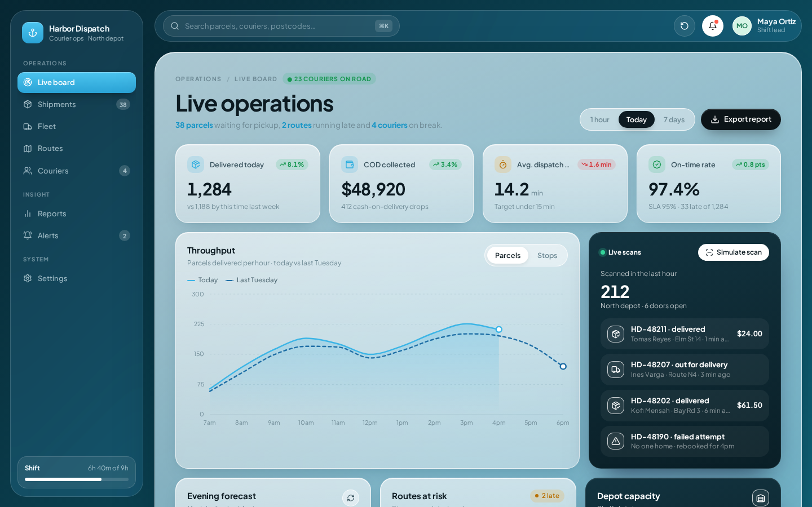

# admin-dashboard-vista

**vista-ui** is a *skill* for LLM agents (Claude Code, Codex, Cursor, Copilot, Windsurf… or any model that can
read markdown) that produces Dribbble-quality **glassmorphism** dashboard UIs: frosted glass panels over gradient
backgrounds, a floating sidebar, big-number KPI cards, smooth SVG charts and pill-shaped buttons —
plus **professional motion**: the page enters in a choreographed sequence, charts draw themselves, numbers count up,
an "active" pill glides between options, light follows the cursor across the glass, and toasts/skeletons/undo feel fluid.

| Lagoon | Indigo |
|---|---|
|  |  |
| **Aurora (spatial)** | **Evergreen (notch)** |
|  |  |
| **Graphite (dark) · SaaS analytics** | **Terracotta (notch) · Reservations** |
|  |  |
| **Orchid · Support inbox** | **Opaline (light) · Settings** |
|  |  |
| **Motion · Live operations** | **Entrance filmstrip (120 → 300 → 500 → 800 ms)** |
|  |  |

## What's inside

```
skills/vista-ui/
├── SKILL.md                 # entry point: the 7-step workflow for the agent
├── assets/
│   ├── vista.css            # design system: tokens, 10 themes, 3 shells, ~50 components (vx- prefix)
│   ├── vista-charts.js      # dependency-free SVG charts: bar, line, area, donut, gauge, ring, sparkline (with draw-in)
│   ├── vista-motion.js      # motion engine: entrance, scroll reveal, count-up, glider, glow/tilt, toast, FLIP
│   ├── vista.js             # icons + toggles for segmented/chips/tabs/switch, live theme switching
│   └── vendor/lucide.min.js # Lucide icon set (ISC) — works offline
├── templates/               # page shells: sidebar.html · notch.html · spatial.html
├── examples/                # 9 complete pages (8 themes, many page types) + theme-gallery.html + index.html (gallery)
├── references/              # in-depth docs, read by the agent only when needed
│   ├── design-language.md   # the style's visual "DNA", do's and don'ts
│   ├── themes.md            # 10 themes, picking a theme per product, generator, brand themes, dark mode
│   ├── palettes.md / .json  # library of 53 mood-based palettes (minimal, warm, cool, vivid, modern)
│   ├── components.md        # copy-paste HTML for every component
│   ├── layouts.md           # shells + page recipes (overview, analytics, tables, gallery, inbox…)
│   ├── charts.md            # chart API
│   ├── motion.md            # motion language: tokens, entrance, patterns, recipes, a11y
│   ├── framework-port.md    # using it with React/Next, Vue, Svelte, Tailwind, shadcn
│   └── checklist.md         # pre-delivery QA checklist
└── scripts/
    ├── scaffold.py          # create a new page from a template (copy or inline assets)
    ├── bundle.py            # inline CSS/JS into a single HTML file
    ├── palette_theme.py     # palette / hex codes → full Vista theme + contrast report
    └── screenshot.py        # PNG capture + reports console errors, bad icon names, empty charts, leftover placeholders; --frames = motion filmstrip
adapters/system-prompt.md    # condensed prompt for agents that can't read the skill folder
install.sh                   # installs the skill for each agent type
AGENTS.md                    # instructions for agents working in this repo itself
```

## 10 themes


| Theme | Feel | Shell | Good for |
|---|---|---|---|
| `lagoon` | teal/cyan glass, black CTA | sidebar | admin, real estate, B2B |
| `indigo` | royal blue glass, navy sidebar | sidebar | e‑commerce, analytics, SaaS |
| `aurora` | warm visionOS-style glass over a room backdrop | spatial (top bar + rail + dock) | personal finance, consumer |
| `evergreen` | moss-green frame, white panels, "notch" tabs | notch | CRM, sales, productivity |
| `graphite` | true dark mode: graphite with lime-yellow accents | sidebar | dev tools, monitoring, analytics |
| `terracotta` | rosy charcoal brown, cream panels, burnt orange | notch | restaurants, hotels, interiors |
| `lapis` | midnight lapis blue, plum glow, ivory panels | sidebar | wealth, luxury, legal |
| `orchid` | vivid purple → pink, lavender glass | sidebar | creators, support, AI |
| `opaline` | light minimal, pearl gray, coral orange | spatial / sidebar | settings, billing, minimal SaaS |
| `marina` | harbor navy, sand panels, brown accents | sidebar | travel, maritime, logistics |

Switch themes: `<html data-theme="indigo">`. See all 10 themes: `examples/theme-gallery.html`.

**More colors:** a library of 53 palettes in `references/palettes.md`, plus one command to turn a palette
(or your brand colors) into a complete theme:
```bash
python3 skills/vista-ui/scripts/palette_theme.py --list                     # browse the 53 palettes
python3 skills/vista-ui/scripts/palette_theme.py 21 --name fireside --out fireside.css
python3 skills/vista-ui/scripts/palette_theme.py "#0F4C81,#F2E8DC,#E07A5F" --name acme
```

## Motion

Just add `<script src="vista-motion.js"></script>` to `<head>` (the templates already include it):

| Moment | Motion |
|---|---|
| Page load | sidebar slides in → panel settles → heading → cards rise in reading order (45ms stagger) |
| Scroll | cards below the fold rise as they enter the viewport |
| Numbers | KPIs count up from 0 at a fixed width so nothing shifts; live updates flash green/red (`countTo`) |
| Charts | bars spring up, lines sweep left → right, donut/gauge/ring sweep around; changing the period redraws |
| Selection | segmented / tabs / nav / dock: an "active" pill glides on a spring |
| Hover | cursor-following light + glowing border (`vx-glow`), 3D tilt (`vx-tilt`), CTA shine |
| Actions | gentle press shrink; loading buttons; glass toasts with a countdown bar, pause on hover, Undo; new rows slide in while others make room (FLIP) |

Intensity: `<html data-vx-motion="subtle|standard|expressive|off">`. `prefers-reduced-motion` is always respected.
Details: `skills/vista-ui/references/motion.md`; live demo: `examples/lagoon-live-ops-motion.html`.

## Installation

```bash
./install.sh claude                 # Claude Code, for all projects (~/.claude/skills/vista-ui)
./install.sh claude-project ~/app   # Claude Code, a single project
./install.sh codex ~/app            # Codex / agents that read AGENTS.md
./install.sh cursor ~/app           # Cursor (.cursor/rules/vista-ui.mdc)
./install.sh copilot ~/app          # GitHub Copilot (.github/copilot-instructions.md)
./install.sh windsurf ~/app         # Windsurf (.windsurf/rules)
```
ChatGPT / Gemini / raw API: paste `adapters/system-prompt.md` into the system prompt and attach `vista.css` plus one example file.

## Try it

After installing, just ask your agent, for example:
> "Build a gym management dashboard: members, monthly revenue, today's classes, evergreen theme."

Or do it by hand:
```bash
python3 skills/vista-ui/scripts/scaffold.py --shell sidebar --theme lagoon --title "Gym — Overview" --out out/gym.html
# fill in the [[placeholders]] …
python3 skills/vista-ui/scripts/screenshot.py out/gym.html --full      # visual check
python3 skills/vista-ui/scripts/screenshot.py out/gym.html --frames 0,150,300,600   # motion filmstrip
python3 skills/vista-ui/scripts/bundle.py out/gym.html -o out/gym.single.html   # single file for sharing
```
The screenshot script needs Playwright: `pip install playwright && python -m playwright install --with-deps chromium`.

Quick look at the examples: open `skills/vista-ui/examples/index.html` in a browser.

## Notes
- The Plus Jakarta Sans font loads from Google Fonts (offline it falls back to Inter/system). Photos in the lagoon example come from Unsplash.
- Icons: Lucide (ISC, see `assets/vendor/LUCIDE-LICENSE.txt`).
